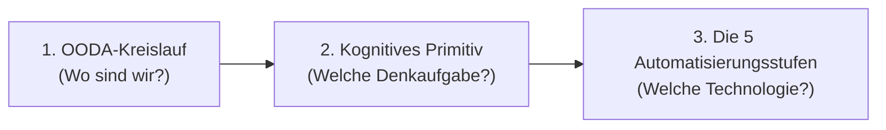

# Prozess-Schulungsdossiers: Auftragsabwicklung verstehen & erklären

Willkommen im Schulungs- und Wissensbereich des **SAP Prozess-Simulators**!

Diese Unterlagen richten sich an **Studenten (BWL, Wirtschaftsinformatik, Wirtschaftsingenieurwesen)** sowie an **angehende Berater und Prozessverantwortliche**, die verstehen wollen, wie moderne Geschäftsprozesse in Unternehmen tatsächlich ablaufen – und wie man sie mit oder ohne Künstliche Intelligenz sinnvoll automatisiert.

> [!NOTE]
> **Keine Techie-Vorkenntnisse nötig:**
> Du musst weder programmieren können noch kryptische SAP-Datenbanktabellen oder Transaktionskürzel auswendig lernen. In der Praxis setzen wir einfach voraus: **Am Ende werden die Daten verlässlich in SAP S/4HANA (ob in der Cloud oder im eigenen Rechenzentrum) gebucht.** 
> Viel wichtiger ist für dich: **Was passiert in der realen Welt? Welche Belege fliegen ein? Welche geschäftliche Entscheidung wird getroffen? Und wie erklärst du das später einem Kunden oder einer Führungskraft?**

---

## 🧭 Unser methodischer Kompass (Die 3 Ebenen)

Um einen Prozess sauber zu analysieren und zu automatisieren, nutzen wir ein bewährtes, klares Denkmodell in drei Schritten:

1. **OODA-Kreislauf (Menschliche Wahrnehmung & Reaktion):**
   * **Observe (Beobachten):** Informationen aufnehmen (Schritt 1: Posteingang, Schritt 2: Beleg auslesen).
   * **Orient (Einordnen):** Bezug zur eigenen Firma herstellen (Schritt 3: Stammdaten abgleichen).
   * **Decide (Entscheiden):** Kaufmännische Regeln anwenden (Schritt 4: Bonität, Preise, Lagerbestand prüfen).
   * **Act (Handeln):** Tatsächlich handeln (Schritt 5: Verbindlich im ERP buchen, Schritt 6: Kunden informieren).

2. **Kognitives Primitiv (Die elementare Aufgabe):**
   * Was muss der Kopf hier tun? Filtern? Extrahieren? Zuordnen? Bewerten? Ausführen? Formulieren?

3. **Die 5 Automatisierungsstufen (Vom starren Regelwerk bis zum KI-Agenten):**
   * **Stufe 1 – Deterministisch:** Feste Regeln („Wenn A, dann B“). Null KI, null Kosten, rasend schnell.
   * **Stufe 2 – Single-Turn KI (Task-Assistent):** Ein einmaliger, isolierter KI-Aufruf (z. B. „Lies dieses unordentliche PDF aus“).
   * **Stufe 3 – Copilot (Der Mensch prüft mit):** Die KI macht einen Vorschlag, aber ein Mensch muss im Bildschirm zwingend auf „Freigeben“ klicken. Unverzichtbar bei hohem Risiko!
   * **Stufe 4 – Workflow (SAP Build / n8n):** Der smarte Standardweg. 95 % laufen vollautomatisch im Hintergrund durch. Nur bei Unklarheiten poppt eine Aufgabe für den Sachbearbeiter auf.
   * **Stufe 5 – Autonomer Agent (Joule AI Agent / KI-Team):** Die KI recherchiert selbstständig, kontaktiert andere Systeme oder Kollegen und löst komplexe Fälle. Sehr mächtig, aber teuer und rechenintensiv.

---

## 📑 Die 6 Prozessschritte im Überblick

Klicke auf den jeweiligen Schritt, um das vollständige Dossier zu öffnen:

| Schritt | Worum geht es im echten Leben? | Kognitives Primitiv | OODA-Phase | Reversibilität / Risiko | Dossier |
|---|---|---|---|---|---|
| **Schritt 1** | **E-Mail-Triage & Posteingang:** Was fliegt da ein? Ist es überhaupt eine Bestellung oder Spam/Reklamation? | **Filter / Gatekeeper** | Observe | 1/5 (völlig harmlos) | [01_step_email_triage.md](01_step_email_triage.md) |
| **Schritt 2** | **Belegdaten auslesen:** Unordentliche PDFs, E-Mail-Texte oder Scans in klare Datenfelder verwandeln. | **Extractor / Transformer** | Observe | 1/5 (gering) | [02_step_pdf_extraction.md](02_step_pdf_extraction.md) |
| **Schritt 3** | **Stammdaten abgleichen:** Wer ist der Kunde wirklich? Welches Produkt aus unserem Katalog will er? | **Matcher / Enricher** | Orient | 2/5 (moderat) | [03_step_master_data_matching.md](03_step_master_data_matching.md) |
| **Schritt 4** | **Kaufmännische Prüfung & Bonität:** Darf der Kunde auf Rechnung kaufen? Reicht unser Lagerbestand? | **Evaluator / Reasoner** | Decide | 3/5 (erheblich) | [04_step_business_rules_credit.md](04_step_business_rules_credit.md) |
| **Schritt 5** | **Auftrag im System anlegen:** Der Nagel mit Köpfchen – Der rechtsverbindliche Vertrag im SAP-System. | **Executor / Actuator** | Act | 5/5 (höchstes Risiko) | [05_step_sales_order_creation.md](05_step_sales_order_creation.md) |
| **Schritt 6** | **Auftragsbestätigung versenden:** Rechtsverbindliches Dokument + freundliche persönliche Nachricht. | **Generator / Synthesizer** | Act | 1/5 (gering) | [06_step_order_confirmation.md](06_step_order_confirmation.md) |

---

## 🎯 Wie du diese Dossiers für deine Prüfungen & Vorträge nutzt

In jedem Dossier findest du folgende Abschnitte, die dir beim Lernen und Formulieren helfen:
1. **Die bildhafte Alltagsszene:** Damit du sofort ein Bild vor Augen hast.
2. **Was kann das alles sein?:** Typische Eingänge und Chaos-Fälle aus der Praxis.
3. **Die fachliche Entscheidung:** Was muss entschieden werden?
4. **Die 5 Automatisierungsstufen:** Wie löst man das in der Praxis und warum ist Stufe 4 oft besser als Stufe 5?
5. **Storytelling & Berater-Kompass:** Wie du den Schritt einem Geschäftsführer in 30 Sekunden erklärst.
6. **Studenten-Spickzettel:** Typische Prüfungsfragen und clevere Musterantworten.
