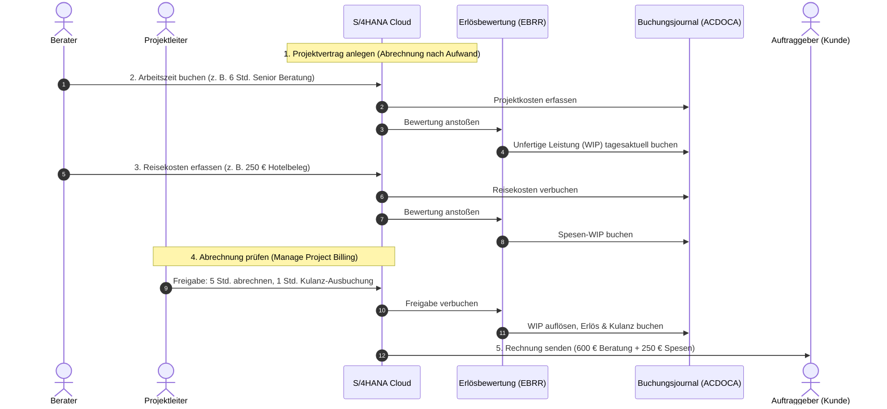

# Architektur-Blueprint
## Abrechnung nach Aufwand und Echtzeit-Bewertung von Projektleistungen

Dokument-ID: NCE-BP-PS-001  
Autoren: Peter Alexander (Next Chapter Experts) unter fachlicher Mitwirkung von Gabriele Hoffmann und Stefan Walz (SAP SE)  
Klassifizierung: Referenz-Blueprint für SAP S/4HANA Cloud Public Edition  
Gültig für: Standard-Geschäftsprozesse in Dienstleistungs- und Beratungsunternehmen  
Status: Freigegeben für Fachbereich und IT-Architektur  

---

## 1. Fachlicher Steckbrief

| Merkmal | Ausprägung |
| :--- | :--- |
| Geschäftsprozess | Projektabrechnung und Bewertung unfertiger Leistungen nach Aufwand (Time & Expense) |
| Typische Einsatzbereiche | Unternehmensberatung, IT-Dienstleistung, Ingenieurbüros, Wirtschaftsprüfung |
| SAP Standard-Szenarien | Kundenprojektmanagement (J11), Zeiterfassung (J12), Projektabrechnung (4E9), Ereignisbasierte Erlösabgrenzung (1IL) |
| Systembasis | SAP S/4HANA Cloud Public Edition |
| Führendes Buchungsjournal | Universal Journal (Tabelle ACDOCA) mit dem Bewertungsverfahren für Projekt-WIP (SPTMWP) |
| Beteiligte Rollen | Berater, Projektleiter, Abrechnungssachbearbeiter, Controlling, Wirtschaftsprüfer |

---

## 2. Ausgangslage und betriebswirtschaftliche Praxis

### 2.1 Wo heute im Tagesgeschäft die Reibungsverluste entstehen

In vielen Dienstleistungsunternehmen läuft die Abrechnung geleisteter Stunden und angefallener Reisekosten immer noch zeitverzögert und intransparent ab. Berater tragen ihre Arbeitszeiten im Projekt ein und reichen Hotel- oder Fahrkartenbelege ein. Was davon jedoch tatsächlich an den Kunden weiterberechnet werden darf und welcher wirtschaftliche Wert sich dahinter verbirgt, bleibt oft wochenlang eine Schätzung.

In der Praxis führt das regelmäßig zu drei konkreten Problemen:

1. **Blindflug bei unfertigen Leistungen:** Bis zum Monatsabschluss weiß die Geschäftsleitung nicht verlässlich, wie viele erbrachte Stunden noch nicht in Rechnung gestellt wurden. Dieser Bestand an Halbfertigarbeiten (Work in Progress, kurz WIP) muss oft manuell geschätzt werden.
2. **Kaufmännische Konflikte bei Budgetgrenzen:** Vereinbart ein Kunde ein festes Budgetlimit (Cap) oder gibt es Zeiten, die aus Kulanz nicht berechnet werden sollen, fällt das oft erst auf, wenn die Abrechnung bereits geschrieben wird. Dann müssen Rechnungen aufwendig storniert oder Positionen im Nachhinein mühsam gekürzt werden.
3. **Mangelnde Nachvollziehbarkeit bei Prüfungen:** Fragt der Wirtschaftsprüfer oder das Controlling, wie sich ein Millionenbetrag an unfertigen Leistungen im Hauptbuch zusammensetzt, fehlen die Einzelbelege. Im Hauptbuch steht oft nur ein Sammelwert, der sich nicht direkt auf einzelne Mitarbeiter, Tage oder Leistungsarten zurückführen lässt.

### 2.2 Der durchgängige Lösungsansatz in S/4HANA Cloud

Die moderne SAP-Architektur löst diesen Bruch zwischen Zeiterfassung, Projektsteuerung und Buchhaltung vollständig auf. 

Sobald ein Berater einen Zeiteintrag bestätigt oder ein Spesenbeleg erfasst wird, passiert im Hintergrund zweierlei gleichzeitig: Die Kosten werden dem Projekt belastet, und das System ermittelt über die ereignisbasierte Erlösabgrenzung (Event-Based Revenue Recognition) sofort den buchhalterischen Wert der Leistung. Dieser Wert wird unmittelbar im Universal Journal (Tabelle ACDOCA) als unfertige Leistung ausgewiesen.

Der Projektleiter sieht in der Anwendung „Manage Project Billing“ tagesaktuell alle offenen Posten. Er kann Standardzeiten mit einem Klick zur Abrechnung freigeben, Überschreitungen kappen oder Zeiten als Kulanz verbuchen. Bei Rechnungsstellung wird der WIP-Posten in den Büchern automatisch aufgelöst und als Erlös verbucht. Für alle Beteiligten – vom Projektleiter über den Kunden bis zum Wirtschaftsprüfer – ist jeder Cent zu jedem Zeitpunkt transparent belegt.

---

## 3. Der Ablauf im Überblick

Das folgende Ablaufdiagramm zeigt das Zusammenspiel zwischen Berater, Projektleitung, System und Auftraggeber von der ersten Leistungserfassung bis zur bezahlten Rechnung.

---

## 4. Die sechs Prozessschritte im Detail

Der Gesamtablauf gliedert sich in sechs praxisnahe Schritte, die klare Verantwortlichkeiten schaffen:

### Schritt 1: Projekt- und Vertragsanlage
Zu Beginn eines Kundenprojekts werden die vertraglichen Rahmenbedingungen im System hinterlegt: Welche Arbeitspakete gibt es, welche Beraterstufen (zum Beispiel Senior Consultant oder Partner) kommen zum Einsatz und welche Stundensätze wurden mit dem Kunden vereinbart? Das System verknüpft diese Daten mit dem Abrechnungsprofil nach Aufwand (Time & Expense).

### Schritt 2: Tagesaktuelle Zeiterfassung der Berater
Die Berater erfassen ihre erbrachten Arbeitszeiten direkt auf die vorgesehenen Arbeitspakete. In dem Moment, in dem die Zeiten freigegeben werden, berechnet das System die entstandenen Kosten und bucht parallel den rechnerischen Gegenwert als unfertige Leistung (WIP) in das zentrale Buchungsjournal. Es gibt keinen Zeitverzug zwischen Arbeitsleistung und buchhalterischer Sichtbarkeit.

### Schritt 3: Erfassung von Reisekosten und Belegen
Reisekosten wie Hotelübernachtungen, Bahnfahrten oder Flugtickets werden belegbezogen auf das Projekt gebucht. Auch hier sorgt die automatische Bewertung dafür, dass abrechenbare Auslagen sofort als Spesen-WIP im System geführt werden, sodass am Monatsende keine Belege verloren gehen.

### Schritt 4: Automatische Vorprüfung vor der Abrechnung
Bevor der Projektleiter die Abrechnung öffnet, führt das System bereits eine Vorprüfung durch: Liegen alle Zeiten im vereinbarten Budgetrahmen? Gibt es vertragliche Deckelungsbeträge (Caps), die erreicht wurden? Das System bereitet die Posten übersichtlich vor und markiert Abweichungen, sodass der Prüfaufwand auf das Wesentliche reduziert wird.

### Schritt 5: Kaufmännische Freigabe durch den Projektleiter
In der Abrechnungsmaske trifft der Projektleiter die eigentliche kaufmännische Entscheidung über drei klare Optionen:
- **Abrechnen (Bill):** Die Leistung wird regulär an den Kunden fakturiert.
- **Deckeln (Cap):** Vertraglich vereinbarte Höchstgrenzen greifen. Der darüber liegende Betrag verbleibt als Abgrenzung im System.
- **Kulanzausbuchung (Write-off):** Ein Mehraufwand oder eine Fehlleistung wird bewusst nicht berechnet. Das System bucht diesen Anteil sauber als nicht verrechenbaren Aufwand aus.

### Schritt 6: Rechnungsstellung und buchhalterischer Ausgleich
Nach der Freigabe erstellt das System die Rechnung an den Kunden mit allen vereinbarten Details. Gleichzeitig werden die unfertigen Leistungen im Hauptbuch aufgelöst und die Umsatzerlöse final verbucht. Am Monatsende sind keine manuellen Nacharbeiten erforderlich, da alle Werte bereits Cent-genau im System stehen.

---

## 5. Klare Trennung: Routine vs. kaufmännische Ausnahmen

Um den täglichen Arbeitsaufwand gering zu halten, folgt der Prozess dem bewährten 80/20-Prinzip:

1. **Rund 85 % Routine (Dunkelverarbeitung):**  
   Arbeitsstunden und Standardspesen, die voll im freigegebenen Budget liegen und keinen Grenzwert verletzen, benötigen keine zeitraubende Einzeldiskussion. Sie werden automatisch für den nächsten Abrechnungslauf gebündelt.

2. **Rund 15 % gezielte Prüfung (Human-in-the-Loop):**  
   Die Aufmerksamkeit der Projektleitung wird gezielt auf Ausnahmefälle gelenkt: Budgetwarnungen, Erreichen vertraglicher Maximalgrenzen oder unklare Spesenbelege. Nur hier greift der Projektleiter aktiv ein und entscheidet über Abrechnung, Deckelung oder Kulanz.

---

## 6. Transparenz für Controlling und Wirtschaftsprüfer

Ein entscheidender Vorteil für die Geschäftsleitung und das Rechnungswesen liegt in der lückenlosen Nachvollziehbarkeit im Buchungsjournal (Universal Journal, Tabelle ACDOCA):

- **Personenbezug:** Jede Buchungszeile enthält die Personalnummer des leistenden Mitarbeiters.
- **Leistungsart:** Es ist exakt erkennbar, welches Produkt abgerechnet wurde (beispielsweise Senior Consultant oder Projektleitung).
- **Mengen und Beträge:** Die exakte Stundenzahl und der Verrechnungssatz sind fest im Beleg verankert.
- **Status:** Ob ein Betrag als unfertige Leistung, berechneter Erlös, gedeckelte Zeit oder Kulanzausbuchung geführt wird, ist im Feld für den Belegzeilentyp festgeschrieben.

Wirtschaftsprüfer können damit jeden ausgewiesenen Bilanzposten ohne manuelle Nebenrechnungen bis auf den einzelnen Zeiteintrag des Beraters zurückverfolgen.

---

## 7. Bereitstellung für den ProzessSimulator

Für die interaktive Simulation und die Analyse von Automatisierungspotenzialen existiert zu diesem Blueprint eine maschinenlesbare Konfigurationsdatei:

- **Konfigurationsdatei:** [`workflow.json`](workflow.json) (im selben Verzeichnis)
- **Verwendung:** Kann direkt im **ProzessSimulator** und im **EnterpriseProzessSimulator** über die Funktion „Neuen Workflow anlegen / Importieren“ geladen werden.
- **Umfang:** Enthält alle sechs Prozessschritte mit Latenzen, Token-Metriken, Clean-Core-Einstufungen und den passenden Werkzeugen der SAP-Standardarchitektur.
